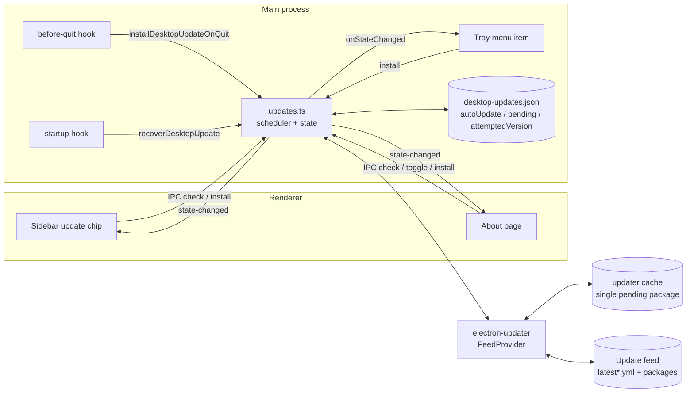
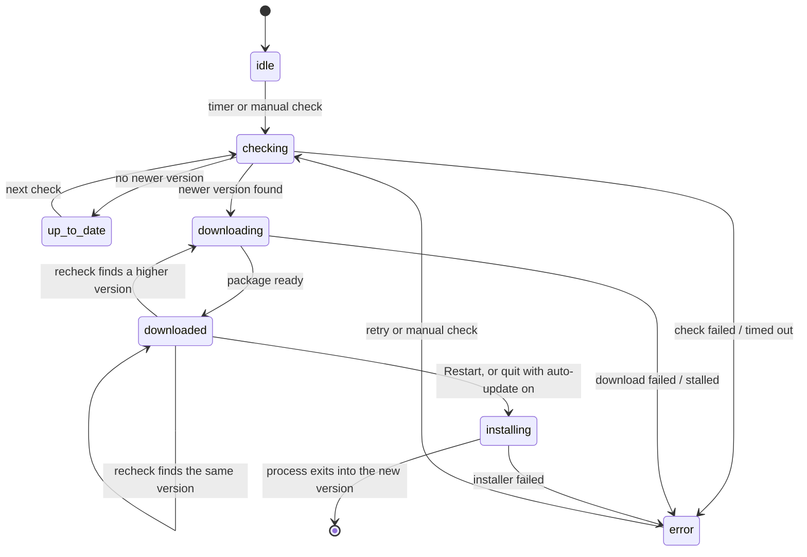
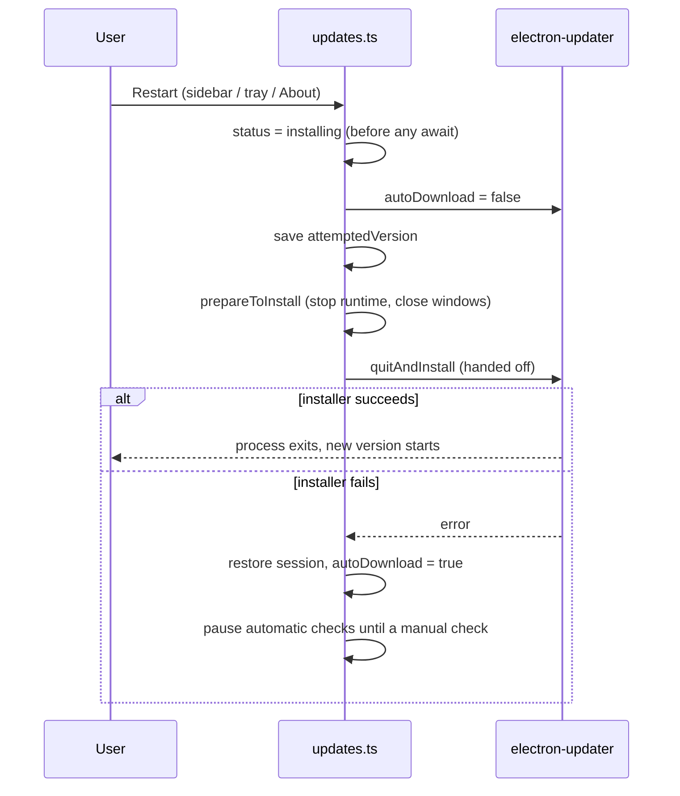

# Desktop Auto-Update

How the Electron desktop client checks for, downloads, and installs updates. Source of truth:

- `apps/desktop/src/main/updates.ts`: scheduling, the electron-updater integration, the install boundary, and startup recovery
- `apps/desktop/src/shared/updates.ts`: the state reducer shared with the renderer
- `apps/desktop/src/main/index.ts`: the tray item, quit hook, and startup hook
- `apps/web/src/components/sidebar/update-chip.vue`: the sidebar entry

## Product rules

- Checking and downloading happen in the background without asking.
- A running window is never restarted or reloaded by the updater. Installation starts only from an explicit Restart (sidebar, tray, About), or from a real quit when automatic updates are on.
- Clicking Restart installs the package that is already downloaded, immediately. There is no last-moment check or download behind the button.
- A failed installation must never turn into a restart loop.

## Components

## Status model

Statuses as seen by the renderer (`DesktopUpdateStatus`):

`unavailable` (no feed configured or updater inactive) is terminal for automatic checks.

Rules enforced by the reducer:

- While `downloaded`, the events `checking`, `not-available`, and `available` for the same version do not change the status, so the Restart entry does not flicker during rechecks.
- A recheck while `downloaded` runs with `autoDownload` off and only starts a download when the feed reports a different version. electron-updater compares the full manifest and empties its cache before any re-download, so a same-version republish must not trigger one; otherwise a failed re-download would leave Restart pointing at a deleted package. A republished package with the same version number is therefore not picked up until the version changes.
- While `installing`, every event except `error` and `preference` is ignored. A check that was already in flight cannot unlock a restart that is under way.

## Timers

| Timer | Value | Purpose |
| --- | --- | --- |
| First check | 3 s after start | Initial check |
| Periodic check | 1 h after a successful check or download | Keeps the downloaded package close to the newest release |
| Retry backoff | 1 min, 5 min, 15 min, then every 60 min | After a check or download failure |
| Feed request timeout | 30 s | Aborts a manifest request that never answers |
| Download stall watchdog | 2 min without progress | Cancels the download and enters the retry backoff |
| Startup recovery window | 8 s | Upper bound on recovering a saved package before the window opens |

The feed request timeout exists because builder-util-runtime arms its own timeout on the `socket` event, which Electron's `net.request` never emits. Without it, a feed that accepts a connection and never answers keeps the check pending, and electron-updater returns that same pending promise to every later check.

Only one schedule timer exists at a time. Automatic checks stop when automatic updates are turned off, when the status is `installing`, and after an installation failure (see below).

## Install boundary

- The lock is set before the first `await`, so double clicks and IPC repeats are no-ops.
- `autoDownload` is turned off because electron-updater reads it when a check resolves. A check that was already running would otherwise start downloading a newer release, and electron-updater deletes the package being installed when it starts a different download.
- `error` events received before the hand-off come from that background check and are ignored. After the hand-off they are treated as installation failures.
- After an installation failure, automatic checks stay paused until the user checks manually (or turns automatic updates off and on). This is the restart-loop guard.

Quit: on a real quit with automatic updates on and a package in `downloaded`, the same path runs with relaunch disabled.

## Startup recovery

Runs before the first window is created, only when `desktop-updates.json` has a `pending` manifest newer than the running version.

1. The pending version already equals the running version: clear the record and continue.
2. `attemptedVersion` equals the pending version (the last install did not take effect): show an error, pause automatic checks, and do not install again.
3. Automatic updates are off: do nothing.
4. Otherwise, let electron-updater validate its cached package against the saved manifest (a custom provider returns the saved manifest without contacting the feed). If the package is ready within 8 s, install and relaunch before any window is shown. If not, open the window normally; a late result may reach `downloaded` but never restarts the visible session.

## Persisted record

`desktop-updates.json` in the app's userData directory:

| Field | Meaning |
| --- | --- |
| `autoUpdate` | User preference for automatic checks and install-on-quit |
| `pending` | Manifest of the downloaded package; used by startup recovery |
| `attemptedVersion` | Version handed to the installer; used to detect an install that did not take effect |

`pending` is written when a download completes. It is cleared when a download fails, and when electron-updater starts downloading a different version, because electron-updater empties its pending cache at that point.

## electron-updater constraints

- It keeps a single pending package and empties it before downloading a different release. No option keeps the previous package (verified against 6.8.9, 6.8.12, and 7.0.0-alpha.12). While a higher version downloads, there is no package to install, so the Restart entries disappear until the new download finishes.
- A Restart clicked within the window between a release and the next periodic check installs the older downloaded package; the next launch picks up the newer one. The 1 h interval keeps that window small; the button itself never waits for a download.

## Known gaps

- An error from a background check that arrives after the installer hand-off is treated as an installation failure. The feed request timeout makes this unlikely.
